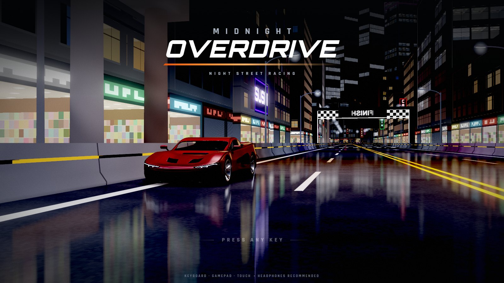
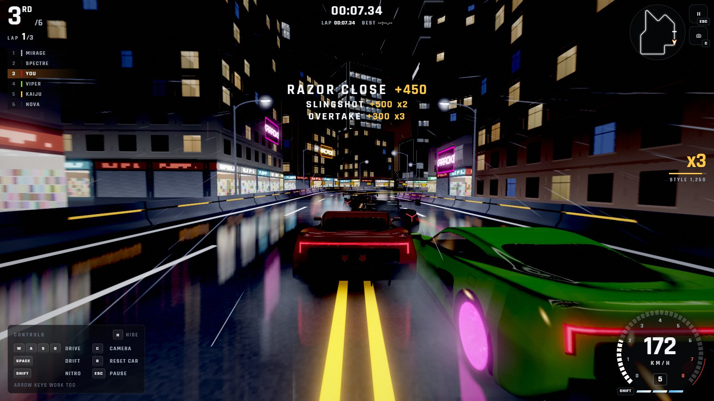
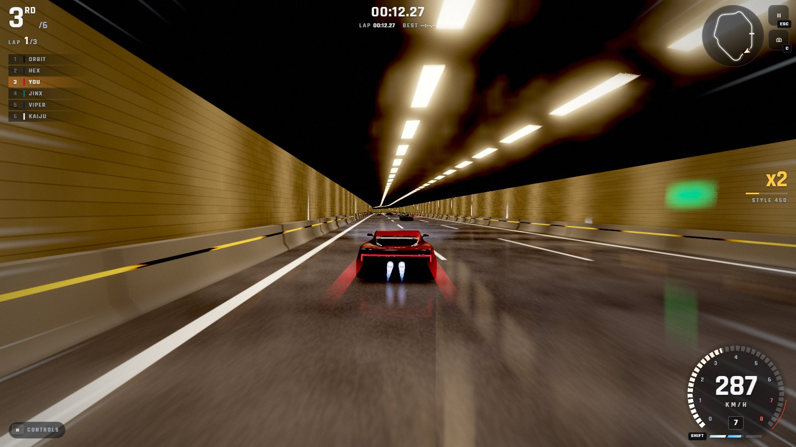
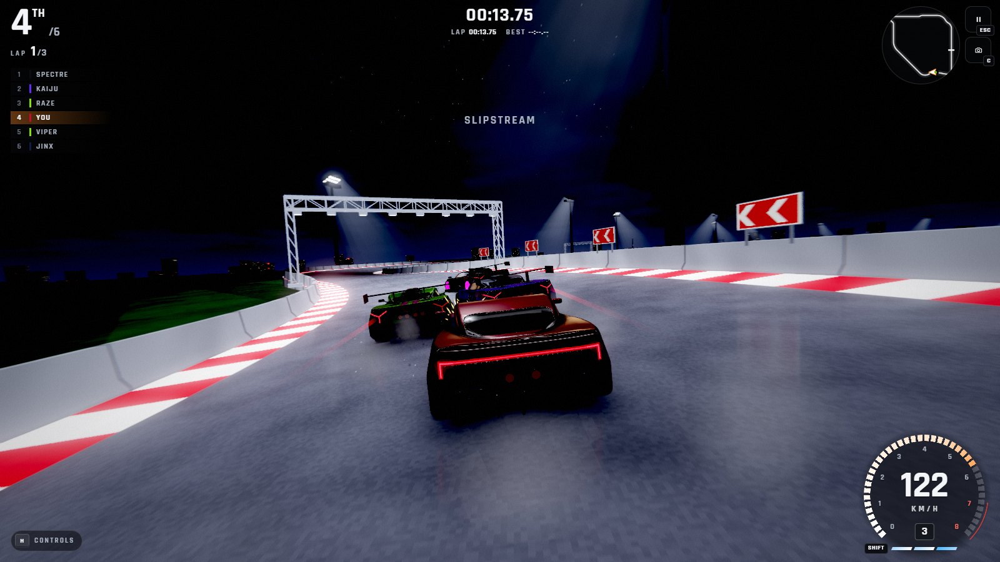
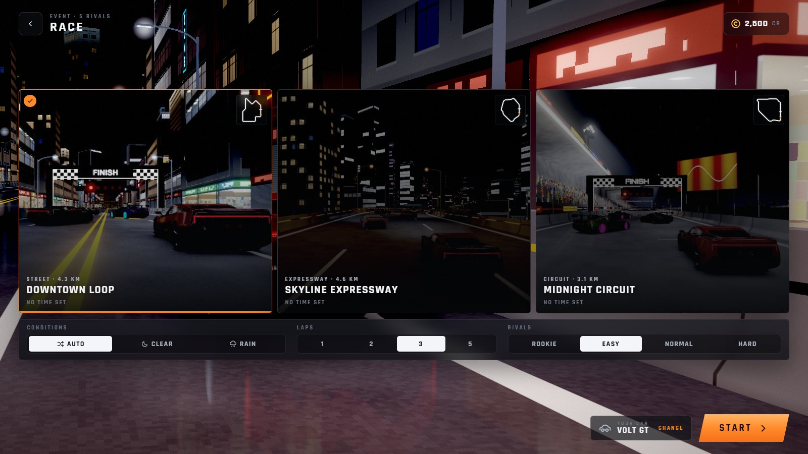
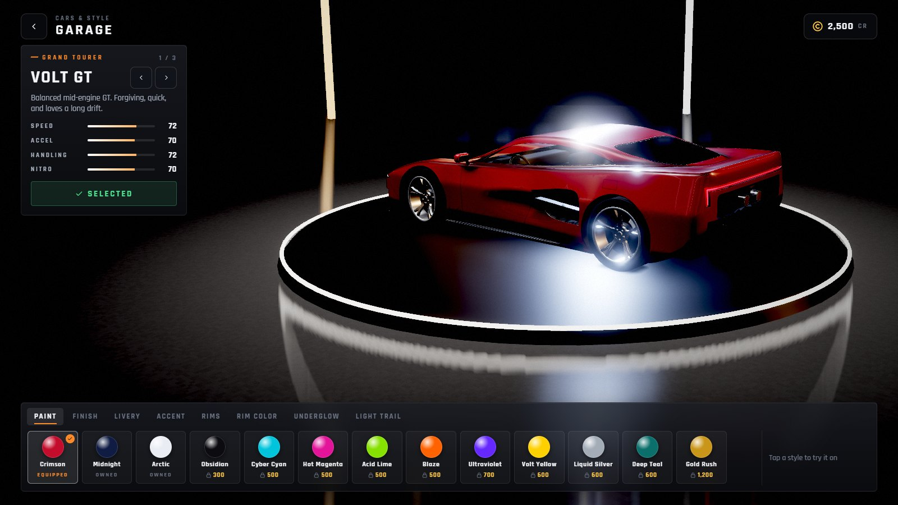
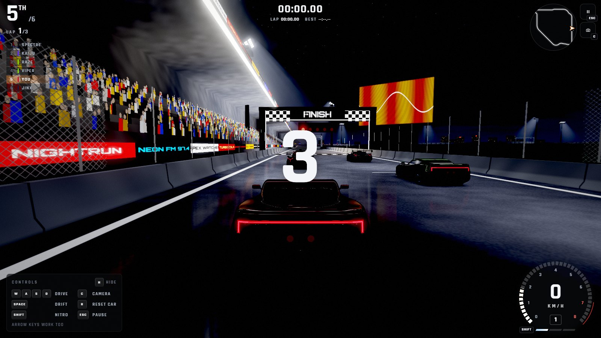

# Midnight Overdrive

**A fast night-time street-racing game that runs right in your web browser.** There's nothing to download or install, and it works on phones, tablets and computers.

### [▶ Play now](https://phuahjinwei.github.io/Car-Racing-ThreeJS/)

---

## What is it?

Midnight Overdrive puts you behind the wheel of a supercar on empty city streets after dark. You race five rival drivers through glowing downtown blocks, a highway with long lit tunnels, and a floodlit stadium circuit. Drift around corners, weave past rivals and fire your nitro to take the lead.

It's an arcade racer: easy to pick up, with no realistic car setup to learn. Press go, hold on, and try not to hit the wall.

## The tracks

There are three tracks, each with its own mood:

| Track | What it's like |
| --- | --- |
| **Downtown Loop** | Tight city blocks between shops, neon signs and apartment windows, with a jump along the way. |
| **Skyline Expressway** | A long, fast elevated highway that dives into lit road tunnels. The place to reach top speed. |
| **Midnight Circuit** | A proper race track in a floodlit stadium, with grandstands, cheering crowds and start lights. |

You can make each track feel new by driving it **backwards**, **mirrored**, or in the **rain**, where the wet road reflects every light in the city.

## How you play

- **Race to win.** Beat five computer-controlled rivals over a few laps. They brake, overtake, use nitro, and sometimes make mistakes just like real drivers.
- **Drift.** Hold the drift button while turning to slide around corners. The longer you drift, the bigger the speed boost when you let go.
- **Nitro.** Fill up your nitro by drifting, driving close to other cars, tucking in behind them (slipstreaming) and landing jumps. Then use it for a burst of speed.
- **Earn points for style.** Near misses, overtakes and drifts build up a combo multiplier. Crash into a wall and the combo is lost.

## Ways to play

- **Race.** The main event. Pick a track, the weather, the number of laps and how tough your rivals are: *Rookie*, *Easy*, *Normal* or *Hard*.
- **Time Trial.** Just you against the clock, chasing a see-through "ghost" car that replays your best lap.
- **Daily Challenge.** A new track every day. Finish it once to collect the day's credits, hit its goal for a bonus, and play on days in a row to build a streak.

## Your garage

Every race earns you credits. Spend them in the garage on five different cars, from a grand tourer and a hypercar to an 80s drift hatchback and a police pursuit sedan, and on ways to make them your own: paint colours, finishes, liveries (stripes, a two-tone "panda" and more), door numbers, window tint, wheels, glowing underlights, and the light trail your car leaves behind at speed.

## Controls

You can play with a **keyboard**, a **game controller**, or **touch** on a phone or tablet.

| To... | Keyboard | Phone / tablet | Game controller |
| --- | --- | --- | --- |
| Steer | A / D or the arrow keys | Stick at the bottom left, or tilt your device | Left stick |
| Accelerate | W or the up arrow | Automatic | Right trigger |
| Brake or reverse | S or the down arrow | Pull the stick down | Left trigger |
| Drift | Space, while turning | Hold DRIFT while turning | X or B |
| Nitro | Shift | NITRO button | A |
| Change camera | C | Camera button | Y |
| Siren (police car) | Q | Siren button | LB |
| Put the car back on the road | R | Happens automatically | Back |
| Pause | Esc | Pause button | Start |

**Tips:**

- Press nitro the moment the lights say **GO** for a perfect start.
- Hold a drift for longer to get a bigger boost when you let go.
- Follow right behind a rival to slipstream: you'll pick up speed and nitro.

## Playing on a phone or tablet

- Turn your phone **sideways** (landscape) to play.
- **Android:** the game goes full screen when a race starts.
- **iPhone and iPad:** for full screen, tap **Share** in Safari, then **Add to Home Screen**, and open the game from the new icon on your home screen.
- Once added to your home screen, the game also works **without an internet connection**.
- The picture quality adjusts itself to keep the game running smoothly. You can change it in **Settings**.

## Good to know

- **It's free,** and there are no ads, accounts or sign-ups.
- **Your progress is saved in your browser** on the device you play on. Clearing your browser's data will reset it, and it doesn't carry over between devices.
- **Headphones are recommended.** The engine sounds and the music build up as the race heats up.
- It works best in an up-to-date version of Chrome, Edge, Safari or Firefox.

---

*Want to look under the hood or run the game yourself? See the [developer notes](DEVELOPMENT.md).*
